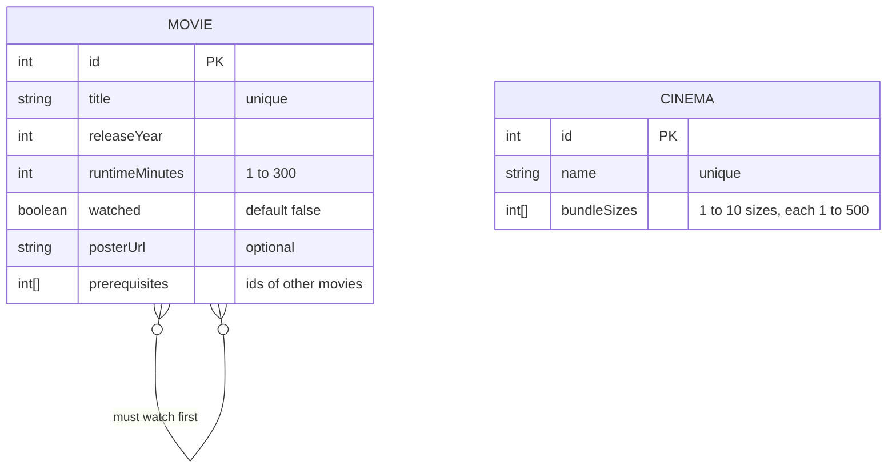

# Doomsday Ready

A small full stack app for MCU fans. It plans the rewatch order before Avengers: Doomsday and works out the cheapest way to book an opening night watch party.

Built with Node.js and Express (API), React (frontend) and Docker Compose.

## How to run

**With Docker (one command):**

```bash
docker compose up --build
```

Open http://localhost:8080. The app starts with the sample movies and cinemas from the assessment.

**Without Docker:**

```bash
# terminal 1
cd backend
npm install
npm run seed
npm start

# terminal 2
cd frontend
npm install
npm run dev
```

Open http://localhost:5173.

**Tests:** run `npm test` inside the `backend` folder.

## Data model



## Choices I made

* **Prerequisites** can be sent as movie ids or exact movie titles.
* **Unique titles and names** ignore upper and lower case, so "iron man" and "Iron Man" count as the same.
* **Release year** was not specified, so I accept 1888 to 2100.
* **Errors:** an unknown movie id gives 404, invalid input gives 400, and a duplicate title or name gives 409.
* **Booking with no exact match** returns a normal response with `possible: false` and a message, not an error.
* **Several valid answers:** the rewatch order and the bundle choice can have more than one correct answer. The API always returns the same one, preferring larger bundles.
* **Cinema bundle sizes** must all be different from each other.
* **Storage** is a JSON file, so no database is needed.
* **Posters** are an optional extra. A movie without one shows a placeholder.

## How I used AI

I used Claude (an AI assistant from Anthropic) to help build this project. It helped me plan the structure, write the code, write the tests and draft this README. The logic for features 1 and 2 (circular dependency check, rewatch order and bundle calculation) is plain code in `backend/src/graph.js` and `backend/src/bundles.js`, with no library solving it.